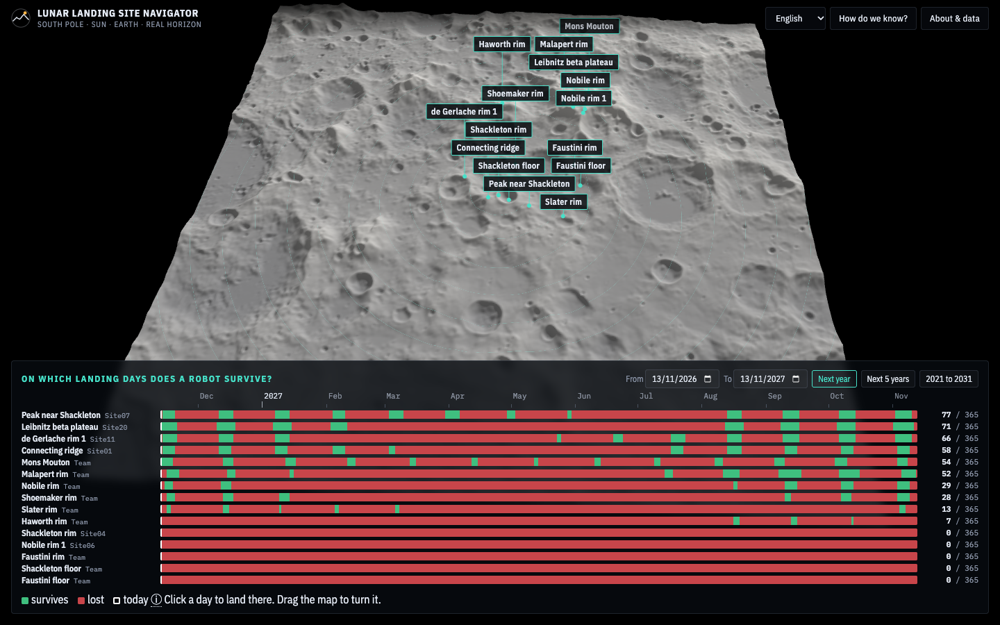
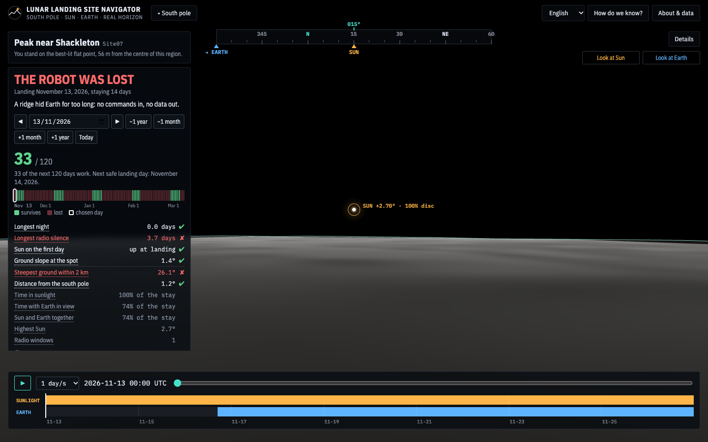

# Lunar Landing Site Navigator

NASA Space Apps Challenge 2026, challenge "Lunar Landing Site Navigator". Team **404 agents**, Naryn. An independent student project, not a NASA product.

**Live app:** https://lunar-navigator-404.web.app · **How it works:** https://lunar-navigator-explained.web.app

> If we land at this site on this day, will a solar robot survive, and on which days would it?




## What it does

1. **A 3D map of the Moon's south pole** that you can drag to turn, with fifteen sites: six from NASA's Lunar Surface Data Book and nine picked by the team on LOLA terrain (crater rims and shadowed floors).
   Under it, **one row per site and one column per landing day**: green survives, red is lost. Set the period yourself, from any day to any day in 2021 to 2031; the best site for that period is listed first. Click a cell to land on that site on that day.
2. **You fly down and stand on it**, 2 m above the real LOLA terrain. The Sun and Earth sit at their true positions. Press ▶ to watch 14 days pass.
3. **One panel gives the answer** for a landing on the chosen day:
   - THE ROBOT SURVIVED or THE ROBOT WAS LOST, and one sentence of why;
   - a strip of the next 120 landing days, green survives, red is lost (click a day to land on it);
   - eleven checks with a tick or a cross (hover a line to read what it means).
4. **Any day from 2021 to 2031**: past days are history, future days are a prediction from the orbit model. The terrain does not change.
5. "Details" brings back every expert number. English, Russian and Kyrgyz for the answer panel.

## The eleven checks

| Priority | Check | Limit | Where the limit comes from |
|---|---|---|---|
| Must pass | Longest night | at most 2 days | team teaching value |
| Must pass | Longest radio silence (Earth hidden) | at most 3 days | team teaching value |
| Must pass | Sun on the first day | up at landing or within 24 hours | team teaching value |
| Must pass | Ground slope at the spot | under 10° | NASA Artemis III requirement |
| NASA site rule | Steepest ground within 2 km | under 20° | NASA Artemis III requirement |
| NASA site rule | Distance from the south pole | within 6° | NASA Artemis III requirement |
| Good to know | Time in sunlight, time with Earth in view, both together, highest Sun, radio windows | none | shown only |

The robot survives when the four "must pass" checks pass. The rules are in `app/mission.js`.

## How we know it is right

| Claim | Check | Result |
|---|---|---|
| Sun and Earth positions (`app/sky.js`, astronomy-engine with the IAU lunar rotation model) match NASA JPL Horizons | `npm run validate` (needs internet) | last run before the cleanup: worst 0.0047° |
| The same positions match an independent JPL DE440 series computed by the Python pipeline, at four sites over 2027 to 2028 | `npm test` | under 0.01° |
| Each rule passes at its limit and fails just past it; three languages have the same texts | `npm test` | passes |
| The app works end to end: fifteen sites, the timeline cells equal the site verdicts, the period can be set, the map turns, eleven checks, any date, three languages, phone width | `npm run smoke` | passes |

The horizon at each site is ray-marched on LOLA `LDEM_80S_80M` (80 m) by the pipeline in `pipeline-3d/`.

## Run it

```bash
npm install
cd app && python3 -m http.server 8000   # then open http://localhost:8000
```

The app is static files, but it needs a web server (it loads ES modules and data files). `npm run deploy` publishes it to Firebase Hosting.

## What is where

| Path | What |
|---|---|
| `app/index.html`, `app/src/`, `app/css/` | the app (three.js) |
| `app/src/verdict.js` | the answer panel |
| `app/src/allsites.js` | the timeline of every site on the map screen |
| `app/mission.js`, `app/sky.js`, `app/i18n.js` | the rules, the Sun and Earth positions, the texts |
| `app/data/` | terrain and horizon for the twenty points (fifteen sites, five with a best spot within 500 m) |
| `pipeline-3d/` | the offline Python pipeline that built `app/data/`. `sh pipeline-3d/add-sites.sh` builds the team's nine sites, then `node tools/eva-slope.cjs` writes the 2 km slope values |
| `tools/` | `test.cjs`, `smoke.cjs`, `validate-horizons.cjs`, `record-demo.cjs` |
| `explainer/` | the "How it works" page |

## Limits, stated plainly

- Fifteen sites, twenty points. Adding a site means running the pipeline for it.
- The nine team sites are not NASA candidate sites. Each is the best-lit point on a named crater's rim, or the lowest point of its floor, that we found on LOLA terrain. Each was checked against JPL Horizons like the six Data Book sites (worst 0.47 arcseconds).
- Terrain is 80 m per pixel; a rock or a small crater below that size is not in the data.
- The 2 day, 3 day and 24 hour limits are our teaching values, not NASA requirements.
- Future dates come from the orbit model; we compared it with NASA data for 2026 to 2028, not for every year.

## Credits and data

- 3D view, terrain pipeline and horizon masks: teammate [steppekid](https://github.com/steppekid/lunar_3d_nasa_hackathon).
- Answer panel, rules, any-date positions, checks: team 404 agents.
- NASA LRO LOLA `LDEM_80S_80M`, PDS Geosciences Node; NASA JPL DE440 and Horizons; site coordinates from NASA M2M-30044 *Lunar Surface Data Book*; NASA Artemis III landing site requirements. Full list with links: `app/ATTRIBUTION.md`.
- Software: three.js (MIT), astronomy-engine (MIT).
- Use of AI (SI) tools: `docs/SI-usage.md`.

Licence: Apache-2.0.
