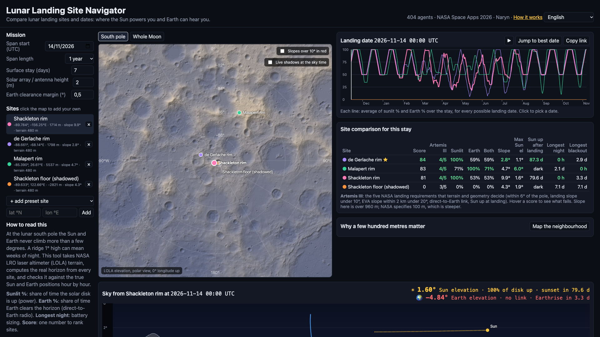

# Lunar Landing Site Navigator

Team **404 agents**, NASA Space Apps Challenge 2026, Naryn local event.
Challenge: *Lunar Landing Site Navigator*.

Compare lunar landing sites and dates by two questions: will the Sun power us, and can we talk to Earth directly?
Built for the south pole, where the Sun and Earth skim the horizon, and usable anywhere on the Moon.



## Live

- App: https://lunar-navigator-404.web.app
- Code: https://github.com/pathmaker7/lunar-landing-site-navigator
- How it works (the problem, the challenge, Space Apps rules, method, results, limits): https://lunar-navigator-explained.web.app
- Demo video (2 min, synthetic placeholder voice): `docs/demo.mp4`, also embedded on the explainer page

The app ships about 7.3 MB of compressed terrain, so the first load takes a few seconds on a fast connection and longer on a slow one; at the event, open the local copy.

## Run it

Open `app/index.html` in any browser. No server, no install, works offline. Interface in English, Russian and Kyrgyz (Russian and Kyrgyz are drafts until reviewed by a native speaker, see docs/translations-review.md).

## What it does

| View | Answers |
|---|---|
| South pole map (LOLA 480 m) | candidate sites; click to add one; red overlay for slopes over 10°; live cast shadows at the chosen time |
| Whole Moon map (LOLA 7.6 km + 474 m around landing sites) | Apollo, Luna, Chang'e, Chandrayaan-3, SLIM, IM-1, IM-2, Blue Ghost; click anywhere or type lat/lon |
| Date planner | for every landing date in the span, how good the stay is (sunlit % and Earth % averaged); jump to the best date |
| Comparison table | per site: score, NASA Artemis III checks (x/5), sunlit %, Earth %, both, slope, max Sun elevation, Sun up after landing, longest night, longest Earth blackout, comm windows |
| Sky panorama | the real 360° skyline with Sun and Earth tracks; Sun and Earth elevation, time to sunset or Earthset, play the stay |
| Neighbourhood map | sunlit % and Earth % for 121 points within about 2.4 km: why a few hundred metres matter |
| Timeline | power and comms over the whole span; export comm windows as CSV |
| Copy link | reopens the same sites, dates, settings and language |

Controls: span start and length, stay length, solar array or antenna mast height, Earth clearance margin.

## How it works

1. **Terrain**: NASA LRO LOLA `LDEM_75S_240M` south polar elevation map, averaged to 480 m per pixel, cropped to 80° S (`tools/build-dem.cjs` makes `app/data/dem.js`). Elsewhere, LOLA `LDEM_4` (7.6 km) for the whole Moon plus 474 m `LDEM_64` boxes, 75 km around each curated landing site (`tools/build-global.cjs` makes `app/data/global.js`, used by `app/globe.js`).
2. **Horizon**: for each whole-degree azimuth, march a great circle across the map and keep the highest elevation angle, with Moon curvature (`app/terrain.js#horizon`).
3. **Sky**: Sun and Earth positions from astronomy-engine, rotated into the Moon body-fixed frame with the IAU WGCCRE lunar rotation model (`app/sky.js`).
4. **Answer**: fraction of the solar disk above the skyline (power), Earth centre above the skyline plus a margin (direct-to-Earth link), runs of night and blackout, and comm windows (`app/analysis.js`).

Preset sites are not typed in by hand. `tools/build-sites.cjs` takes crater centres from the USGS Gazetteer of Planetary Nomenclature and picks the best-lit DEM point on each rim ring over one year.

## Verification

Every check below was broken on purpose once and went red before it was trusted.

| Check | Command | Result | How it was proven able to fail |
|---|---|---|---|
| Sun and Earth az/el vs NASA JPL Horizons, 5 sites (3 polar, Apollo 11 near side, Chang'e 4 far side), 30 days | `npm run validate` | worst 0.0047° (limit 0.1°) | `SKY_BIAS_DEG=0.2 npm run validate` fails |
| Sunlight and Earth visibility vs NASA's published LOLA illumination maps (PGDA product 69, Mazarico et al. 2011), 131 points, 18.6 years, same definitions | `npm run crosscheck` | median difference 0.3 pp (Sun), 0.2 pp (Earth) | `ILLUM_ROTATE_DEG=180 npm run crosscheck` fails (14.9 and 22.8 pp) |
| Disk fraction, run detection, time to sunset/Earthset, slope (Shackleton floor under 5°, wall over 20°), Artemis III check boundaries, map orientation, whole-Moon map orientation and 474 m patch registration (median 4.5 m), Apollo 11 horizon under 3°, cast-shadow rays agree with horizon profiles, every interface string exists in all three languages, every browser script parses | `npm test` | pass | off-by-one, wrong slope baseline, loosened pole limit, patch shift, flipped longitude, deleted translation, broken syntax each fail |
| App loads in headless Chrome without errors; map click; shared link restores state; a site name with HTML is shown as text; a broken link falls back to defaults; neighbourhood centre equals the site's own numbers; RU and KY applied; no sideways scroll at 390 px phone and 1920x1080 projector | `npm run smoke` | pass, screenshots in docs/screenshots | removing the name filter, the link guard, the layout fix, or using a different mast in the neighbourhood each fail |
| Explainer page: no sideways scroll at 390 px and 1920 px, no broken image, links to the app; the app header links to the explainer | `npm run smoke` | pass | a long link overflowing a phone (found on first run), a deleted image and a wrong header link each fail |
| Both deployed sites: app loads all sites, explainer images and the 120 s video load, phone and projector widths | `npm run live` | both live sites OK | |
| One-year results table below | `npm run results` | the table is pasted from its output | |

## Cross-check against NASA's illumination maps

NASA's LOLA team publishes average Sun and Earth visibility for the south pole (18.6 years, hourly, any part of the disc visible, surface level). `npm run crosscheck` computes ours with exactly those definitions at 131 points (11 presets plus a grid from 85 to 89.5° S) and reads NASA's pixels by HTTP range requests.

- At the single NASA pixel under each point, the median difference is 0.3 percentage points for the Sun and 0.2 for Earth; 88% and 91% of points agree within 5 points.
- At the best-lit ridge points our value runs from 0.8 points lower to 4.9 points higher than the best NASA pixel within 240 m (Shackleton rim 90.2% vs 85.8%), consistent with 480 m terrain slightly lowering the skyline. Nobile rim is the outlier: +10.6 points against the best pixel within 240 m, +1.6 against the best within 480 m.
- The averaged 4 x 4 NASA block can be tens of points lower at a ridge (Shackleton rim 61%), because one 120 m pixel off the crest is already in shadow. Sunlight at the pole changes within a few hundred metres; the neighbourhood map in the app shows this.

## One-year results (14 Nov 2026 to 14 Nov 2027, 2 m mast, 0.5° Earth margin, 2 h steps)

Generated by `npm run results` (same terrain and maths as the app). Slope is over a 960 m baseline.

| Site | Sunlit | Earth | Both | Longest night | Longest blackout | Slope | Terrain |
|---|---|---|---|---|---|---|---|
| Shackleton rim | 86.9% | 48.7% | 43.0% | 3.0 d | 14.4 d | 9.9° | 480 m |
| de Gerlache rim | 82.2% | 53.5% | 44.4% | 7.8 d | 13.3 d | 2.8° | 480 m |
| Slater rim | 56.0% | 42.0% | 25.4% | 20.3 d | 16.7 d | 2.3° | 480 m |
| Shoemaker rim | 50.4% | 45.4% | 25.4% | 25.7 d | 15.3 d | 0.4° | 480 m |
| Faustini rim | 56.3% | 38.0% | 20.5% | 21.0 d | 17.6 d | 4.2° | 480 m |
| Haworth rim (Malapert massif side) | 83.1% | 85.2% | 69.0% | 11.6 d | 4.8 d | 3.9° | 480 m |
| Malapert rim | 60.7% | 78.5% | 46.1% | 15.9 d | 6.5 d | 4.7° | 480 m |
| Nobile rim | 85.9% | 65.7% | 53.1% | 11.3 d | 10.1 d | 4.4° | 480 m |
| Mons Mouton (best-lit point) | 54.7% | 100.0% | 54.7% | 16.1 d | 0.0 d | 3.9° | 480 m |
| Shackleton floor (shadowed) | 0.0% | 0.0% | 0.0% | 365.1 d | 365.1 d | 4.3° | 480 m |
| Faustini floor (shadowed) | 0.0% | 0.0% | 0.0% | 365.1 d | 365.1 d | 8.9° | 480 m |
| Apollo 11 | 51.2% | 100.0% | 51.2% | 14.8 d | 0.0 d | 0.8° | 474 m |
| IM-2 Athena | 46.8% | 77.9% | 37.2% | 19.0 d | 6.8 d | 2.2° | 480 m |
| Chandrayaan-3 | 49.7% | 100.0% | 49.6% | 16.0 d | 0.0 d | 0.8° | 474 m |
| Chang'e 4 (far side) | 48.9% | 0.0% | 0.0% | 15.2 d | 365.1 d | 0.0° | 474 m |

## Limits

- 480 m terrain at the pole, 474 m around curated sites, 7.6 km for custom points elsewhere (labelled "coarse" in the app): local boulders and small ridges are smoothed out.
- Slope is measured over a 960 m baseline, so real slope under a lander is steeper; treat the 10° warning as a minimum filter.
- Direct-to-Earth only: no relay satellites.
- The horizon ignores refraction (the Moon has no atmosphere, so this is correct) and the lander's own shadow.

## Rebuild the data

```bash
npm install
curl -O https://pds-geosciences.wustl.edu/lro/lro-l-lola-3-rdr-v1/lrolol_1xxx/data/lola_gdr/polar/img/ldem_75s_240m.img
npm run build:dem -- ldem_75s_240m.img
npm run build:sites   # about 4 minutes
curl -O https://pds-geosciences.wustl.edu/lro/lro-l-lola-3-rdr-v1/lrolol_1xxx/data/lola_gdr/cylindrical/img/ldem_4.img
npm run build:global -- ldem_4.img   # about 7 minutes: reads 474 m boxes from the 530 MB LDEM_64 by HTTP range
```

## Video and deploy

```bash
node tools/record-demo.cjs   # screen footage, 120 s
npm run video                # title and end cards + voice + footage -> docs/demo.mp4 (pass a voice.m4a to use a real recording)
npm run deploy               # copies screenshots and video into explainer/, deploys app/ and explainer/ to Firebase Hosting
npm run live                 # checks both live sites
```

## References

- NASA LRO LOLA polar gridded data, LDEM_75S_240M: https://pds-geosciences.wustl.edu/lro/lro-l-lola-3-rdr-v1/lrolol_1xxx/data/lola_gdr/polar/img/
- Polar stereographic projection definition (DSMAP_POLAR.CAT): https://pds-geosciences.wustl.edu/lro/lro-l-lola-3-rdr-v1/lrolol_1xxx/catalog/dsmap_polar.cat
- NASA LRO LOLA global gridded data, LDEM_4 (whole-Moon map, 7.58 km/px) and LDEM_64 (474 m/px boxes around curated sites, read with HTTP range requests): https://pds-geosciences.wustl.edu/lro/lro-l-lola-3-rdr-v1/lrolol_1xxx/data/lola_gdr/cylindrical/img/
- Landing site coordinates (Apollo, Luna, Chang'e, Chandrayaan-3, SLIM, IM-1, Blue Ghost M1): Wikipedia, "List of landings on extraterrestrial bodies", wikitext fetched 2026-11-13, which cites LROC and NSSDCA: https://en.wikipedia.org/wiki/List_of_landings_on_extraterrestrial_bodies
- IM-2 Athena coordinates (84.7906 S, 29.1957 E): Wikipedia "IM-2", citing LROC image 1408: https://en.wikipedia.org/wiki/IM-2 and https://www.lroc.asu.edu/images/1408 (the list page above gives 85 S 31 W, which is wrong)
- NASA Space Apps 2026 challenge statement, Lunar Landing Site Navigator: https://www.spaceappschallenge.org/2026/challenges/lunar-landing-site-navigator/
- NASA LOLA polar illumination maps, AVGVISIB_75S_120M_201608 (Sun and Earth), PGDA product 69: https://pgda.gsfc.nasa.gov/products/69 ; method: Mazarico, E., et al. (2011), Illumination conditions of the lunar polar regions using LOLA topography, Icarus 211, 1066 to 1081, doi:10.1016/j.icarus.2010.10.030
- Artemis III landing requirements (6° of the pole, landing slope under 10° over 100 m, EVA slope under 20° over 2 km, direct-to-Earth link, lighting): NASA Artemis Overview for the International Space Apps Challenge, NTRS 20250009323 (listed below)
- NASA JPL Horizons API (validation): https://ssd.jpl.nasa.gov/api/horizons.api
- IAU WGCCRE 2009 report (lunar rotation model): https://astropedia.astrogeology.usgs.gov/download/Docs/WGCCRE/WGCCRE2009reprint.pdf
- USGS Gazetteer of Planetary Nomenclature (crater centres): https://planetarynames.wr.usgs.gov/
- NASA Artemis Overview for the 2025 International Space Apps Challenge: https://ntrs.nasa.gov/api/citations/20250009323/downloads/ArtemisOverview2025IntSPAPPSChallenge.pdf
- astronomy-engine 2.1.19 (MIT): https://github.com/cosinekitty/astronomy

## SI (AI) usage

See [docs/SI-usage.md](docs/SI-usage.md). Space Apps requires every submission to describe it.

## License

Apache 2.0, see [LICENSE](LICENSE). astronomy-engine is MIT. NASA data is public domain.
